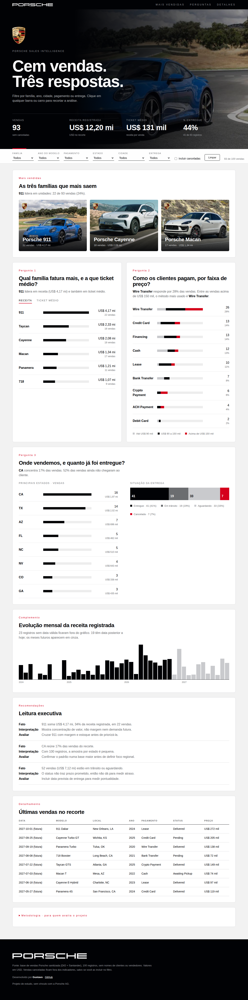
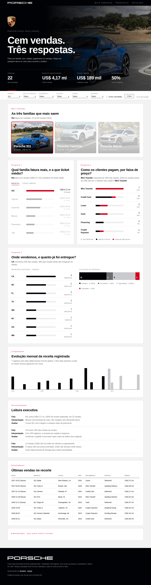

# Porsche Sales Dashboard

Dashboard interativo para explorar uma base demonstrativa de vendas de veículos Porsche, com indicadores, filtros e visualizações por modelo, cidade e estado.

## Demonstração ao vivo

**[Abrir o dashboard publicado](https://pilotogrs88.github.io/dashboard_porsche_sales/)**

## Visão geral

O dashboard permite explorar os registros por meio de filtros, comparar famílias de veículos e consultar indicadores e status de entrega. Os valores e registros exibidos devem ser tratados como dados demonstrativos, não como informações oficiais da Porsche.

## Estrutura do repositório

```text
dashboard_porsche_sales/
├── index.html
├── README.md
└── docs/
    ├── print.png
    └── print-filtro.png
```

## Capturas de tela

### Visão geral



### Dashboard com filtros aplicados



## Tecnologias

- HTML
- CSS
- JavaScript

## Publicação

O projeto é uma aplicação estática hospedada pelo GitHub Pages. O arquivo `index.html` fica na raiz da branch `main`.

## Dados e privacidade

Esta demonstração deve utilizar somente dados fictícios, públicos ou devidamente anonimizados. Não publique planilhas originais, dados pessoais ou informações comerciais confidenciais no HTML, JavaScript ou em arquivos acessíveis publicamente.

## Autor

Desenvolvido por Gustavo Silva.  
GitHub: [@pilotogrs88](https://github.com/pilotogrs88)
